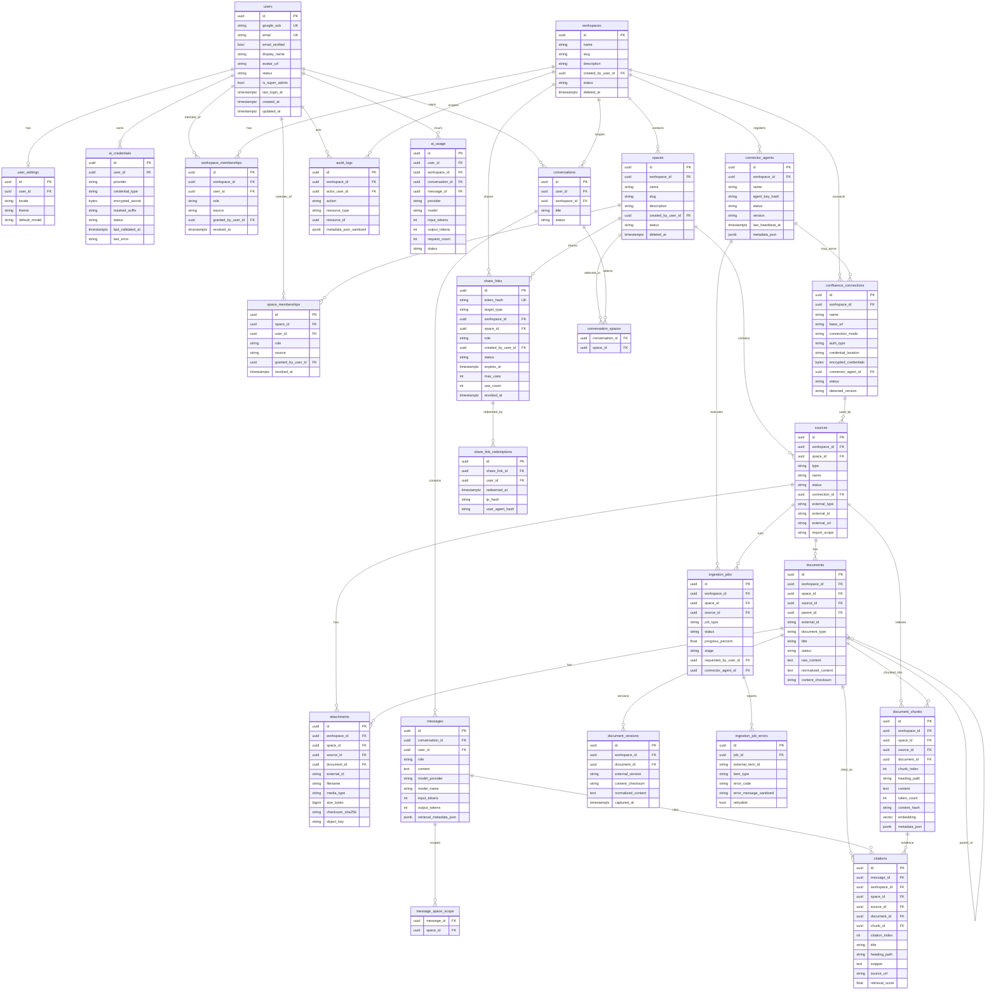

# Entity Relationship Diagram

Mermaid ERD for MVP core entities. Soft-delete and audit fields abbreviated where repeated.

## Key constraints (logical)

| Rule | Enforcement |
|------|-------------|
| Max 10 owned workspaces per user | Transaction-safe count of non-deleted workspaces by `created_by_user_id` |
| Unique active workspace membership | `(workspace_id, user_id)` where `revoked_at IS NULL` |
| Unique active space membership | `(space_id, user_id)` where `revoked_at IS NULL` |
| Unique document external id per source | `(source_id, external_id)` where external_id not null |
| Conversation spaces same workspace | App + DB check: space.workspace_id = conversation.workspace_id |
| Share token | Store `token_hash` only; raw token shown once |
| Vector search | Always filter `workspace_id` (+ space_ids) in query |
